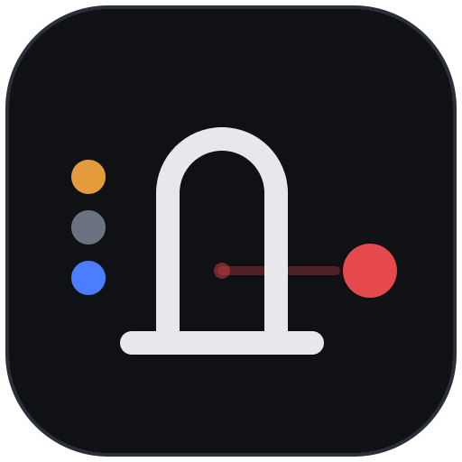
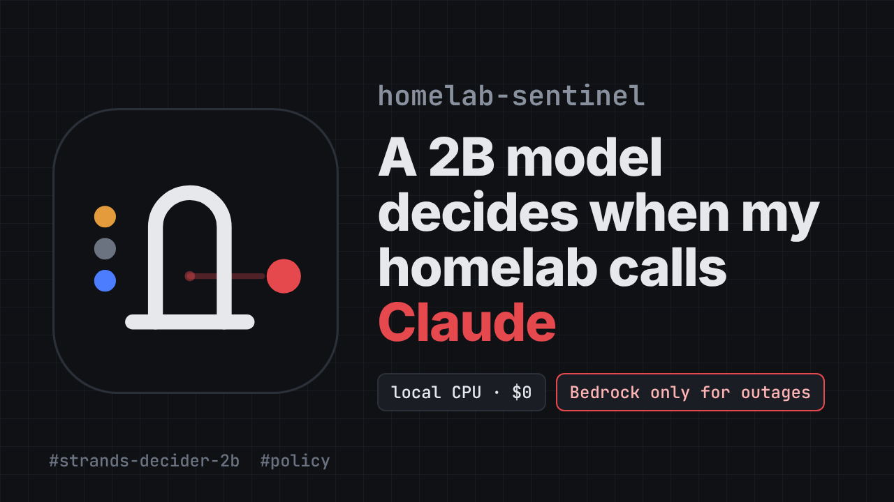

<p align="center"></p>

<h1 align="center">homelab-sentinel</h1>

A small local model decides which events deserve a big one.

Strands Decider 2B runs on a 2014 CPU in my homelab and looks at every event the server produces: container restarts and crashes, Netdata alarms, backup runs. It answers one question, *what happened on this server?*, and a routing table in code turns the answer into an action. Routine events and planned changes never leave the house. Outages and failed backups go to Claude on Amazon Bedrock, which reads the logs with read-only tools and sends the cause and the exact fix commands to Telegram.

Built for the AWS Agent Experience Hackathon. Decision pattern: `#policy`.

[](https://youtu.be/j9PYNzrp5UE)

**Demo video (1:50):** https://youtu.be/j9PYNzrp5UE

## How it works

```
docker events      Netdata alarms      lifeboat backups (systemd)
        \                |                  /
         collectors: pre-computed facts, bursts merged, tool jargon translated
                         |
                   Strands Agent
     ├─ LogTriageGate     before_invocation   Decider 2B, local, ~3.5 s, $0
     │                                        not an outage -> Deny, zero model calls
     ├─ BedrockBudget     before_model_call   model calls per hour cap
     ├─ KnownContainers   before_tool_call    tools only touch containers that exist
     └─ Claude Sonnet 4.6 on Bedrock          read-only tools: logs, status, stats,
                                              host resources, backup journal
                         |
   escalate  -> Telegram now: Cause / Evidence / Fix / Confidence; a crash loop alerts once per 15 min
   notify    -> Telegram now, short, 10 min cooldown per service
   digest    -> one Haiku 4.5 summary at 21:00 (no Bedrock call on a quiet day)
   drop      -> decision log only
```

## The decision

```python
QUESTION = "What happened on this server?"
CRITERIA = {
    "routine":           "normal background activity, nothing changed",
    "planned_change":    "an operator or an update intentionally restarted, stopped or changed something",
    "recovered_failure": "something crashed or failed but is running again",
    "ongoing_outage":    "a service is down or unhealthy right now",
    "resource_risk":     "disk, memory or CPU is running out or trending toward failure",
    "data_at_risk":      "a backup or other data protection job failed or is overdue; nothing is down yet, but data is unprotected",
}
```

| Decider says | Route |
|---|---|
| `ongoing_outage`, `data_at_risk` | escalate to Bedrock |
| anything else with P(`ongoing_outage`) >= 0.25 | escalate to Bedrock |
| confidence < 0.5 | the more cautious of the top two routes, at most notify |
| `recovered_failure`, `resource_risk` | notify |
| `planned_change` | digest |
| `routine` | drop |

Decider classifies, the table decides severity. Changing what gets escalated is a one-line edit, with no retraining and no prompt tuning. The pattern is packaged on its own, with a Strands `InterventionHandler`, in [decision_patterns/log_triage](decision_patterns/log_triage).

## Numbers

Dell T1700, Intel i5-4590 (2014, 4 cores, no GPU), 16 GB RAM, 17 other containers running. Full tables in [docs/benchmarks.md](docs/benchmarks.md), the story in [docs/devlog.md](docs/devlog.md).

| | |
|---|---|
| Decider decision (int8 + bf16 embeddings) | 3.1-3.7 s, 4.0 GB RAM (fp32: 7.7 GB), $0 |
| Fixtures in the expected category | 10 of 10 |
| Fixtures that reached Bedrock | 4 of 10, exactly the outages and failed backups |
| Outage analysis, Sonnet 4.6 | about 5 s, $0.014-0.026 per incident |
| Real traffic, Tue 17:28 to Thu 12:20 UTC (about 40 h) | 0 events, 0 Bedrock calls, $0; the 21:00 digest skipped Bedrock |
| 10-minute live scenario on the same server: 9 events | 5 handled by Decider alone, 4 sent to Bedrock, $0.087 actual vs $0.195 if every event went to Bedrock |
| Planned operations on 4 real containers (6 events incl. one Netdata alarm) | 5 stayed local; 1 false escalation (a deliberate `docker stop`), $0.025 |

## Try it

You need Linux with Docker, Python 3.12+, about 8 GB of free RAM while Decider loads (4 GB after), and AWS credentials that can invoke Claude on Bedrock. Step by step: [docs/setup.md](docs/setup.md).

```bash
python -m venv .venv && . .venv/bin/activate
pip install -r requirements.txt
cp .env.example .env                       # AWS region, Bedrock model ids, Telegram (optional)
python scripts/decider_int8.py 8765 --embed-bf16 &   # Decider 2B on CPU
python -m sentinel.main                    # watch events and decide

scripts/demo.sh restart    # planned_change -> digest, no Bedrock call
scripts/demo.sh crash      # ongoing_outage -> Sonnet reads the logs -> Telegram
scripts/demo.sh oom        # out of memory -> Bedrock fix with the right docker update flags
scripts/demo.sh backup     # failed restic run -> data_at_risk -> Bedrock
scripts/scenario.sh        # all of the above plus planned operations, then a cost report
```

Tests need neither AWS nor a GPU: `python -m unittest discover -s tests`.

## Layout

| Path | What |
|---|---|
| `decision_patterns/log_triage/` | the reusable pattern: question, categories, routing policy, `LogTriageGate` |
| `sentinel/collectors/` | Docker events, Netdata alarms, lifeboat backup units |
| `sentinel/analyst.py`, `guards.py`, `tools.py` | the Strands agent, its three interventions, read-only tools with secret redaction |
| `sentinel/main.py` | the loop: collect, coalesce, decide, notify, log |
| `sentinel/digest.py` | daily Haiku 4.5 digest |
| `sentinel/report.py` | traffic and cost report from the decision log |
| `sentinel/bench.py`, `experiment.py` | measuring Decider on fixtures |
| `scripts/decider_int8.py` | Decider 2B with int8 Linears and bf16 embeddings for small machines |
| `scripts/demo.sh`, `scenario.sh` | demo incidents and the full live run |
| `deploy/` | systemd units (memory-capped Decider, sentinel, digest timer) |
| `tests/` | unit tests with fixtures and a scripted model |

## License

MIT
